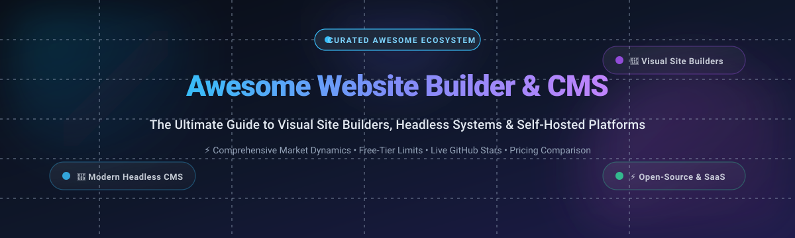

  

# 🌐 Awesome Website Builder & Content Management (CMS)

  
  
  
  
  
  

**Curated directory of top-tier SaaS website builders, visual low-code page editors, and open-source Content Management Systems (CMS).**

*Compare pricing models, enterprise valuations, free tier limits, and live GitHub stars for visual design tools, headless CMS engines, and self-hosted publishing platforms.*

---

## 📑 Table of Contents

- [📊 Sector Overview & Market Dynamics](#-sector-overview--market-dynamics)
- [☁️ SaaS & Hosted Platforms](#️-saas--hosted-platforms)
- [💻 Open-Source GitHub Projects](#-open-source-github-projects)
  - [🏆 Top Open-Source Projects Ranked by GitHub Stars](#-top-open-source-projects-ranked-by-github-stars)
  - [🧩 Architectural Comparison & Implementation Insights](#-architectural-comparison--implementation-insights)
- [📈 Star History](#-star-history)
- [💖 Support & Sponsorship](#-support--sponsorship)
- [🤝 How to Contribute](#-how-to-contribute)
- [⚖️ Disclaimer & License](#️-disclaimer--license)

---

## 📊 Sector Overview & Market Dynamics

The global **Website Builder & Web Content Management (WCM/CMS)** market is estimated at **$21.8 billion to $24.5 billion**, expanding at a compound annual growth rate (**CAGR of 9.4%–11.8%**) toward an estimated **$40+ billion** in the next several years.

The sector exhibits **moderate fragmentation with polarized consolidation at both ends**:
- **Consolidated at the base**: In general publishing and legacy web presence, **WordPress** commands a near-monopolistic footprint (powering over 40% of all global websites), while public giants **Shopify, Wix, and Squarespace** control the commercial SMB and e-commerce segments.
- **Fragmented in specialized verticals**: Rapid innovation in modern decoupled architectures has fragmented developer tools across **Headless CMS APIs** (Strapi, Payload, Directus, Contentful, Sanity), **Visual No-Code Canvas engines** (Webflow, Framer, Webstudio), and **Git-based / static site architectures** (TinaCMS, Decap CMS, Publii). Rather than a single winner-take-all monopoly across the board, the sector has bifurcated into **visual design platforms** for marketing teams and **headless composable data backends** for modern engineering organizations.

---

## ☁️ SaaS & Hosted Platforms

Below is a detailed comparison of market-leading hosted website builders and SaaS content management platforms, sorted in descending order by **Company Size (Revenue / Market Capitalization / Valuation)**.

| SaaS Platform | Company Size (Revenue / Valuation) | Pricing (Starting Tier) | Free Tier Limit / Trial Plan | Primary Focus & Capabilities |
| :--- | :--- | :--- | :--- | :--- |
| **[Shopify](https://www.shopify.com/)** | **~$105 Billion Market Cap** (~$7.06B Ann. Revenue) | **$39/month** (Basic plan, billed monthly; $29/mo billed annually) | **3-day free trial**; followed by promotional $1/month for the first month | Industry-standard e-commerce store builder, multichannel payment processing, global inventory management, and expansive App Store ecosystem. |
| **[HubSpot Website Builder](https://www.hubspot.com/)** | **~$28 Billion Market Cap** (~$2.17B Ann. Revenue) | **$20/seat/month** (Content Hub Starter, billed monthly; $15/mo annually) | **Free forever plan**: up to 25 website pages, 1 blog with up to 100 posts, HubSpot branding, 99.95% uptime hosting, and custom domain connection | All-in-one CMS integrated with CRM; built-in SEO tools, lead capture forms, live chat, and unified customer database marketing. |
| **[Wix](https://www.wix.com/)** | **~$9.5 Billion Market Cap** (~$1.56B Ann. Revenue) | **$17/month** (Light plan, billed annually) | **Free forever plan**: 500 MB cloud storage, 500 MB monthly bandwidth, Wix subdomain (`username.wixsite.com/site`), Wix branded footer ads | Free-form unstructured drag-and-drop website builder with App Market for bookings, appointments, restaurant menus, and lead generation. |
| **[Squarespace](https://www.squarespace.com/)** | **~$6.9 Billion Valuation** (Acquired by Permira in 2024; ~$1.01B Ann. Revenue) | **$25/month** (Personal plan, billed monthly; $16/mo annually) | **14-day free trial** with full access to editor and design templates; no live domain publication without paid plan | Structured responsive grid builder (Fluid Engine) renowned for designer-grade aesthetics, integrated scheduling, portfolios, and e-commerce. |
| **[Webflow](https://webflow.com/)** | **~$4.0 Billion Valuation** (~$130M+ ARR) | **$18/month** (Basic site plan, billed monthly; $14/mo annually) | **Free forever Starter workspace**: 2 published pages, 50 CMS database items, 1 GB monthly bandwidth, and `.webflow.io` staging domain | Visual development canvas generating semantic HTML/CSS/JS with full flexbox and CSS grid control, animations, and exportable frontend code. |
| **[Framer](https://www.framer.com/)** | **~$2.0 Billion Valuation** (~$50M+ ARR) | **$10/site/month** (Mini plan, billed annually; $5/mo billed yearly on legacy/discount) | **Free forever plan**: 1,000 monthly visitors, Framer subdomain (`sitename.framer.app`), Framer badge, up to 10 CMS items, unlimited design canvas | Design-first visual website builder with native Figma-like layout canvas, modern typography, responsive breakpoints, and rich interactions. |
| **[WordPress.com](https://wordpress.com/)** | **~$1.0 Billion Valuation** (Automattic valuation; ~$300M+ Ann. Revenue) | **$7/month** (Starter plan; Explorer at $14/mo, Business at $33/mo) | **Free forever plan**: 1 GB storage, free WordPress.com subdomain (`name.wordpress.com`), community support, WordPress.com branded ads | Fully managed hosting environment for WordPress; unlocks premium themes, automatic core updates, and managed Jetpack security. |
| **[Weebly](https://www.weebly.com/)** | **~$365 Million Acquisition** (Acquired by Block / Square) | **$13/month** (Personal plan, billed monthly; $10/mo annually) | **Free forever plan**: 500 MB cloud storage, free SSL certificate, Weebly branded subdomain, Square checkout integration for basic sales | Simple drag-and-drop website and storefront builder designed for local merchants, small storefronts, and Square POS users. |
| **[Duda](https://www.duda.co/)** | **~$200 Million Valuation** (~$50M+ ARR, backed by Susquehanna) | **$25/month** (Basic plan, billed monthly; $19/mo annually) | **14-day free trial** with full agency suite features and team collaboration; no credit card required | White-label website builder engineered specifically for digital agencies, web design firms, and multi-client SaaS platforms. |
| **[Ghost(Pro)](https://ghost.org/)** | **~$15 Million+ ARR** (Bootstrapped Non-Profit Foundation) | **$11/month** (Starter tier, billed monthly; $9/mo billed annually for 500 members) | **14-day free trial** with full feature set, automated newsletter sending, and zero credit card required | Premium hosted subscription platform optimized for independent newsletters, paid digital publications, media publishers, and creators. |

---

## 💻 Open-Source GitHub Projects

Explore the most prominent open-source website builders, headless CMS engines, and self-hosted publishing platforms.

### 🏆 Top Open-Source Projects Ranked by GitHub Stars

Below, projects are ordered in descending order of community popularity, linked directly to their stargazer communities:

1. **[Strapi](https://github.com/strapi/strapi)**   
   🚀 Leading open-source headless CMS written in 100% JavaScript and TypeScript. Delivers an intuitive Content-Type Builder GUI, role-based access controls, automatic REST and GraphQL API scaffolding, and database support for PostgreSQL, SQLite, and MySQL.

2. **[Ghost](https://github.com/TryGhost/Ghost)**   
   📰 Independent publishing platform (MIT license) built for modern journalism, blogs, newsletters, and member subscriptions. Features integrated Stripe recurring billing, transactional email newsletters, and clean Node.js publishing performance.

3. **[Payload](https://github.com/payloadcms/payload)**   
   ⚡ Fullstack Next.js-native headless CMS framework (MIT license). Runs directly within the React Server Components `/app` directory with zero network hops via Local API, schema-as-code TypeScript types, and pluggable PostgreSQL, SQLite, or MongoDB backends.

4. **[Directus](https://github.com/directus/directus)**   
   🐰 Dynamic data platform and headless backend that instantly wraps any SQL database (PostgreSQL, MySQL, SQLite, Oracle) with both REST/GraphQL endpoints and a clean no-code collaborative administration suite.

5. **[Medusa](https://github.com/medusajs/medusa)**   
   🛍️ The flexible open-source modular commerce and digital storefront engine for developers; acts as a composable open-source Shopify alternative with complete API-first flexibility.

6. **[GrapesJS](https://github.com/GrapesJS/grapesjs)**   
   🎨 Extensible open-source multi-purpose Web Builder Framework (BSD-3-Clause). Designed for software engineers building embedded visual page builders, newsletter email designers, and in-app templates without external dependencies.

7. **[WordPress](https://github.com/WordPress/WordPress)**   
   🌐 The world's most widely adopted open-source Content Management System (GPLv2+). Powers over 40% of the internet with Gutenberg visual block editing, 60,000+ plugins, and an unrivalled ecosystem for blogs and WooCommerce stores.

8. **[Decap CMS](https://github.com/decaporg/decap-cms)**   
   📁 Single-page React application for Git-based static site generators (formerly Netlify CMS). Edits content and automatically commits Markdown, JSON, or YAML directly to GitHub, GitLab, or Bitbucket.

9. **[Grav](https://github.com/getgrav/grav)**   
   ⚡ Ultra-fast, flat-file PHP CMS powered by Symfony and Twig templating. Requires zero SQL database setup—storing content exclusively in markdown files with a built-in package manager and REST API capabilities.

10. **[TinaCMS](https://github.com/tinacms/tinacms)**   
    🦙 Open-source headless CMS supporting real-time visual editing directly on your live website pages, preserving Git as the source of truth for all structured Markdown and MDX files.

11. **[KeystoneJS](https://github.com/keystonejs/keystone)**   
    💎 TypeScript-native headless CMS and backend toolkit built around GraphQL schemas, automated CRUD database migrations, Prisma ORM, and fine-grained field-level session security.

12. **[Webstudio](https://github.com/webstudio-is/webstudio)**   
    🖌️ Open-source visual website builder and Webflow alternative. Connects to any headless CMS, supports all CSS flexbox/grid properties, and exports high-performance clean static pages.

13. **[Instatic](https://github.com/CoreBunch/Instatic)**   
    🤖 Agentic self-hosted visual CMS alternative to Webflow and Framer that bakes static HTML pages straight to disk, paired with sandboxed QuickJS-WASM extensibility.

14. **[Publii](https://github.com/GetPublii/Publii)**   
    🖥️ Desktop-native GUI application (Windows, macOS, Linux) that builds blazing-fast static websites locally with zero server attack vectors or database maintenance.

15. **[Joomla!](https://github.com/joomla/joomla-cms)**   
    🏛️ Enterprise-ready PHP CMS featuring native multilingual content translation, advanced user access control (ACL), and comprehensive audit logging without requiring third-party plugins.

16. **[Statamic](https://github.com/statamic/cms)**   
    🔥 Modern flat-file and hybrid CMS built on Laravel. Blends the speed of flat-file markdown storage with full database power and dynamic Control Panel visual editing.

17. **[Drupal](https://github.com/drupal/drupal)**   
    🏢 Enterprise CMS platform renowned for scalable content modeling, taxonomy structures, multisite governance, and rigorous government/corporate digital accessibility.

18. **[Craft CMS](https://github.com/craftcms/cms)**   
    🛠️ Flexible, content-first CMS tailored for bespoke digital web experiences, custom Matrix fields, Twig templates, and multi-environment deployment workflows.

19. **[Silex](https://github.com/silexlabs/Silex)**   
    ✨ Free and libre visual website creator (AGPL-3.0) that generates clean static HTML files without running a heavy server CMS runtime.

20. **[Squidex](https://github.com/Squidex/squidex)**   
    🐙 Open-source headless CMS and content management hub built on .NET and MongoDB, featuring real-time event-sourcing and multi-channel asset distribution.

21. **[Frappe Builder](https://github.com/frappe/builder)**   
    🧱 Modern open-source visual page builder (MIT) from the Frappe & ERPNext team, enabling responsive page authoring with intuitive drag-and-drop elements.

22. **[Silverstripe CMS](https://github.com/silverstripe/silverstripe-cms)**   
    🌿 Developer-friendly PHP CMS and web application framework with an ergonomic authoring interface and flexible ORM.

---

### 🧩 Architectural Comparison & Implementation Insights

| Architecture Archetype | Best For | Standout Candidates | Architectural Trade-offs |
| :--- | :--- | :--- | :--- |
| **Traditional All-in-One CMS** | Non-technical end users, content-heavy blogs, editorial news | WordPress, Joomla, Drupal, Silverstripe | Massive theme/plugin ecosystems, but requires ongoing plugin updates, database maintenance, and security hardening. |
| **Headless & Composable CMS** | Modern Next.js/React frontends, mobile apps, omnichannel apps | Strapi, Payload, Directus, KeystoneJS, Squidex | Complete UI flexibility and clean API decoupling, but requires front-end engineering teams to build presentation templates. |
| **Visual Static & Low-Code Builders** | Designers, marketing landing pages, agency client sites | Webstudio, Silex, Frappe Builder, Instatic | Instant visual feedback and exportable HTML, though complex dynamic backends may require custom API wiring. |
| **Git-Based / Flat-File CMS** | Developers, technical writers, documentation portals | TinaCMS, Decap CMS, Grav, Statamic | Zero database footprint and complete Git revision history, but limited for non-technical clients unfamiliar with Git PR flows. |
| **Publishing & Newsletters** | Creators, subscription media outlets, independent authors | Ghost | Built-in email newsletters and Stripe monetization, but intentionally narrow for non-blog layouts. |

---

## 📈 Star History

---

## 💖 Support & Sponsorship

If you find this curated resource helpful for your technology evaluations, benchmarking, or development stack, please consider supporting ongoing maintenance:

- ⭐ **Star this repository** to improve discoverability on GitHub!
- 🍴 **Fork and share** with colleagues, designers, and engineering teams.
- ☕ **Buy us a coffee** via the [GitHub Sponsors Dashboard](https://github.com/sponsors/ishandutta2007).

Your sponsorship helps keep data, market valuations, and pricing tiers accurate and up-to-date!

---

## 🤝 How to Contribute

Contributions, corrections, and new entries are always welcome!

1. Fork the repository.
2. Check that the tool or platform aligns with Website Builder or Content Management functionality.
3. Edit `README.md` maintaining table formatting, pricing specifics, company metrics, and live stargazer badges.
4. Submit a Pull Request with a brief summary of additions or updates.

---

## ⚖️ Disclaimer & License

- This repository is a community-curated research resource and does not constitute formal financial, architectural, or vendor endorsement.
- Verify license compliance before commercial deployment (e.g., GPL, MIT, BSD, or copyleft AGPL obligations when distributing SaaS variants).
- Released under the [MIT License](LICENSE).
